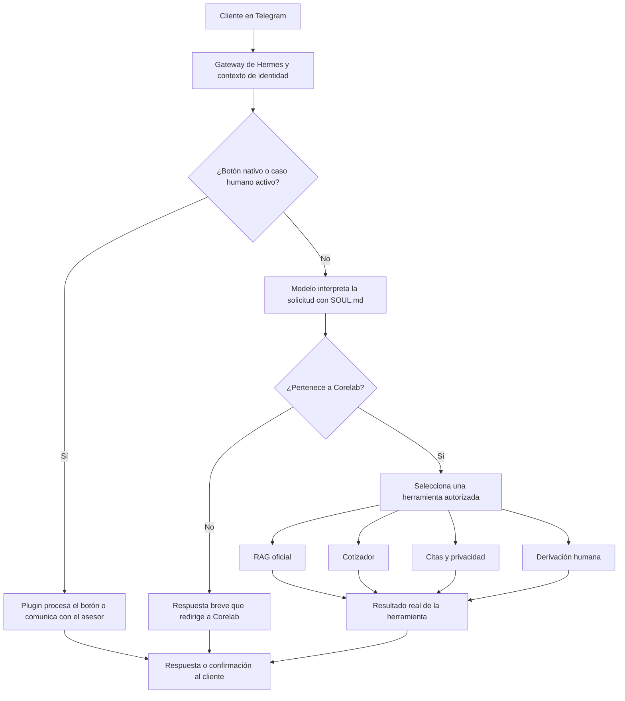

# CoreBot: agente conversacional y agéntico de Corelab

Sistema de atención al cliente para **Corelab Laboratorio Clínico**, desarrollado sobre **Hermes Agent**, con recuperación de información mediante RAG, cotización de exámenes, agendamiento en Google Calendar y derivación a asesores humanos desde Telegram.

**Alcance documentado:** piloto en Windows nativo, perfil `default` de Hermes y un bot de Telegram. Las instrucciones corresponden a los paquetes desarrollados en este proyecto y a la instalación de referencia. No presuponen un despliegue en WhatsApp ni una integración con el sistema clínico del laboratorio.

## Contenido

- [Problema y solución](#problema-y-solución)
- [Funcionalidades y componentes](#funcionalidades-y-componentes)
- [Requisitos técnicos y dependencias](#requisitos-técnicos-y-dependencias)
- [Organización del repositorio y rutas](#organización-del-repositorio-y-rutas)
- [Configuración e instalación paso a paso](#configuración-e-instalación-paso-a-paso)
- [Ejecución habitual](#ejecución-habitual)
- [Pipeline general](#pipeline-general)
- [Pruebas y criterios de aceptación](#pruebas-y-criterios-de-aceptación)
- [Mantenimiento y diagnóstico](#mantenimiento-y-diagnóstico)
- [Limitaciones y trabajo pendiente](#limitaciones-y-trabajo-pendiente)
- [Referencias](#referencias)

## Problema y solución

### Problema

Los clientes necesitan consultar servicios, precios, preparación documentada, horarios y ubicación del laboratorio, además de solicitar citas o atención de una persona. La atención manual concentra consultas repetidas en el personal y exige consultar distintas fuentes para responder.

Un asistente de propósito general puede inventar información, responder temas ajenos a Corelab o confundir nombres parecidos de exámenes. También es necesario separar la información pública del laboratorio de los datos privados de cada cliente y controlar qué operaciones puede ejecutar el agente.

### Solución implementada

CoreBot utiliza un modelo de lenguaje para comprender la solicitud y elegir herramientas nativas de Hermes. El RAG recupera documentación oficial para las respuestas informativas. Los plugins ejecutan operaciones concretas con controles en código: cálculo de cotizaciones, consulta y confirmación de citas y derivación a personal autorizado.

La información que no puede confirmarse se deriva a validación humana. El alcance de atención se limita a Corelab. Las respuestas clínicas, los diagnósticos y la interpretación de resultados personales se remiten a profesionales del laboratorio.

**Distinción técnica:** el RAG y el cotizador utilizan los mismos archivos de catálogo como fuente, pero realizan operaciones diferentes. El RAG recupera fragmentos para responder preguntas; el cotizador lee las tablas Markdown y calcula con precios estructurados y aritmética decimal.

## Funcionalidades y componentes

| Componente | Responsabilidad | Implementación del proyecto |
|---|---|---|
| Hermes Agent | Ejecutar el modelo, administrar sesiones y registrar herramientas | Instalación administrada de Hermes |
| Telegram | Recibir mensajes y botones y entregar respuestas | Gateway de Hermes, con un único bot |
| RAG nativo | Consultar conocimiento oficial y gestionar notas privadas autorizadas | Paquete original `rag-memory-plugin`, con adaptación directa de su registro y aislamiento |
| Carga de conocimiento | Importar Markdown y comprobar la existencia de embeddings | `corelab-cargar-conocimiento`, comando local `indexar.cmd` |
| Precarga RAG | Inicializar el modelo de embeddings al arrancar el gateway | `rag-memory-precarga`, hook `gateway:startup` en el mismo proceso |
| Cotizador | Resolver nombres y sumar precios publicados | Plugin `corelab-cotizador` **1.0.1** |
| Atención humana | Asignar casos y comunicar al cliente con un asesor | Plugin `corelab-handoff` **2.0.1** |
| Citas y privacidad | Consultar cupos, reservar, cancelar y registrar autorización de datos | Plugin `corelab-citas` **1.3.1** disponible |
| Menús | Ocultar el catálogo de comandos técnicos a clientes | Plugin `corelab-menu` **1.0.0** |
| Personalidad y procedimientos | Definir alcance, tono y condiciones para utilizar las herramientas | Archivo activo `SOUL.md` y bloques añadidos por los instaladores |

Los `.cmd` son lanzadores administrativos de Windows. Ejecutan los scripts Python incluidos en cada paquete. Los plugins aportan las capacidades ejecutables; las instrucciones actuales de uso residen en `SOUL.md`. No se requiere una skill adicional para el flujo implementado.

### Herramientas disponibles para el agente

| Toolset | Herramientas |
|---|---|
| `rag_memory` | `rag_search`, `rag_add_document`, `rag_scope` |
| `corelab_cotizador` | `cotizar_examenes` |
| `corelab_handoff` | `derivar_a_humano` |
| `corelab_citas` | `privacidad_citas`, `consultar_cupos`, `solicitar_cita`, `mis_citas`, `cancelar_cita` |

`rag_scope` es una herramienta de diagnóstico, no una operación necesaria durante la atención normal. `corelab-menu` trabaja con manejadores de Telegram y no agrega herramientas al modelo. La indexación y el reinicio administrativo de autorización se ejecutan localmente y no se exponen a clientes.

## Requisitos técnicos y dependencias

### Entorno de referencia

| Requisito | Referencia y finalidad |
|---|---|
| Sistema operativo | Windows nativo x64, conforme a los lanzadores y al cifrado DPAPI utilizados |
| Hermes Agent | Entorno del piloto identificado como `v0.21.5+3840.g9a0a162`, commit `9a0a1625` |
| Python de Hermes | Python administrado **3.14.7** en la instalación de referencia |
| RAG | `rag-memory-plugin` original **1.0.0**, instalado en el entorno activo de Hermes y con los cambios nativos del proyecto |
| Embeddings | `sentence-transformers/all-MiniLM-L6-v2`, **384 dimensiones** |
| Modelo conversacional | Proveedor configurado en Hermes con soporte de llamadas a herramientas y acceso vigente |
| Mensajería | Bot de Telegram, token configurado en Hermes y cuentas separadas de cliente y asesor |
| Agenda | Cuenta Gmail propietaria de un calendario secundario privado y proyecto Google Cloud con Calendar API habilitada |
| Navegador | Necesario para la autorización OAuth del administrador del calendario |

Los lanzadores entregados buscan el Python base en:

```text
%LOCALAPPDATA%\hermes\tools\python-3.14.7+20260901-win32-x64\python.exe
```

Después usan `hermes_bootstrap` para resolver el entorno administrado activo. No dependen del hash particular de un `venv`. Si cambia la ruta o la API de Hermes, se debe adaptar y validar el lanzador correspondiente antes de utilizarlo.

### Dependencias de ejecución

- **Hermes y su SDK de plugins:** registro de herramientas, manejadores de plataforma, tareas de mantenimiento y contexto de sesión.
- **`python-telegram-bot`:** integración con Telegram. Las pruebas del proyecto utilizan el SDK real **22.8** con transporte en memoria; la versión efectiva del servidor la administra Hermes.
- **`rag-memory-plugin`, `sentence-transformers` y NumPy:** motor de recuperación y generación/consulta de embeddings. Se necesitan las dependencias neuronales del paquete original para los modos `neural` y `hybrid`.
- **PyYAML:** lectura y escritura de la configuración de Hermes.
- **Biblioteca estándar de Python:** `sqlite3`, `decimal`, `difflib`, `contextvars`, `asyncio`, `threading`, `urllib`, `http.server` y utilidades de archivos y hashes, entre otras.
- **DPAPI de Windows:** protección del token OAuth de Google para el usuario del sistema que autoriza y ejecuta el gateway.

El cotizador utiliza `Decimal` y `SequenceMatcher` de la biblioteca estándar. La conexión a Google utiliza solicitudes HTTP y OAuth implementados en el paquete; estos módulos no requieren instalar `google-api-python-client`. No se utiliza un servidor vectorial externo en esta implementación.

Los instaladores propios no instalan un segundo Python, otro bot ni dependencias mediante un `pip` global. Instalar el RAG únicamente en un entorno independiente como `.rag-memory` no lo hace visible automáticamente para el intérprete activo de Hermes.

### Accesos y conectividad

El servidor requiere salida hacia Telegram, el proveedor del modelo conversacional y las APIs OAuth/Calendar de Google. La primera descarga o la reconstrucción de la caché del modelo puede necesitar acceso a Hugging Face. La autorización OAuth utiliza un puerto temporal de `127.0.0.1`; el bot no necesita publicar un servidor HTTP propio para ese callback local.

No se estableció un mínimo formal de RAM, GPU o un tiempo de respuesta garantizado. El modelo de embeddings se carga localmente y su funcionamiento depende de los recursos del servidor y de su caché.

## Organización del repositorio y rutas

### Organización sugerida del código

Este README puede ubicarse en la raíz del repositorio. Los entregables existentes se distribuyen por paquetes; la siguiente tabla propone cómo reunirlos sin cambiar sus scripts internos. Las carpetas de esta tabla deben crearse al incorporar los archivos al repositorio: no implican que ya exista un monorepositorio publicado.

| Ruta dentro del repositorio | Contenido |
|---|---|
| `README.md` | Documentación técnica general |
| `knowledge/` | Markdown oficial de Corelab revisado para consulta de clientes |
| `persona/` | Plantilla de personalidad y procedimientos, sin secretos |
| `paquetes/rag-memory-aislamiento/` | Adaptación del registro nativo, aislamiento y pruebas |
| `paquetes/rag-memory-precarga/` | Hook de precarga, instalador y verificación |
| `paquetes/corelab-cargar-conocimiento/` | Indexador administrativo |
| `paquetes/corelab-cotizador/` | Plugin, instalador, datos de referencia y pruebas |
| `paquetes/corelab-atencion-humana/` | Plugin de atención humana y administración de asesores |
| `paquetes/corelab-menu-clientes/` | Plugin de menús y restauración |
| `paquetes/corelab-citas-google/` | Plugin de citas, OAuth, privacidad, auditoría y reinicio de pruebas |

Cada paquete conserva su `LEEME`, sus pruebas y sus scripts. Los archivos `.cmd`, los `.py` y los recursos de un paquete deben permanecer juntos después de extraerlo.

### Rutas del servidor

En el piloto, el directorio activo del perfil `default` es `%LOCALAPPDATA%\hermes`. Los plugins que admiten `HERMES_HOME` usan la ruta activa que les indique Hermes.

| Ruta de referencia | Finalidad |
|---|---|
| `%LOCALAPPDATA%\hermes\config.yaml` | Configuración activa, plugins y toolsets |
| `%LOCALAPPDATA%\hermes\SOUL.md` | Personalidad y reglas del agente |
| `%LOCALAPPDATA%\hermes\agent-knowledge` | Carpeta de documentación oficial que usa el indexador del piloto |
| `%LOCALAPPDATA%\hermes\plugins\corelab-cotizador` | Código del cotizador |
| `%LOCALAPPDATA%\hermes\plugins\corelab-handoff` | Código de atención humana |
| `%LOCALAPPDATA%\hermes\plugins\corelab-citas` | Código y aviso PDF de citas |
| `%LOCALAPPDATA%\hermes\plugins\corelab-menu` | Código de menús |
| `%LOCALAPPDATA%\hermes\plugin-data\corelab-handoff\handoff.db` | Casos, asignaciones y asesores |
| `%LOCALAPPDATA%\hermes\plugin-data\corelab-citas\appointments.db` | Citas, datos del piloto y evidencia de autorización |
| `%LOCALAPPDATA%\hermes\plugin-data\corelab-citas\google-token.bin` | Token OAuth protegido con DPAPI |
| `%LOCALAPPDATA%\hermes\logs` | Estados de los plugins y registros del servidor |
| `%LOCALAPPDATA%\hermes\backups` | Respaldos creados por los scripts administrativos |
| `%USERPROFILE%\.hermes\plugins\rag-memory\rag_core.db` | Base RAG original que se conservó en este proyecto |

La base RAG y el directorio activo de Hermes tienen rutas distintas de manera intencional en el piloto. No se debe cambiar una por la otra al copiar configuraciones. `rag_memory.plugin` puede residir en las fuentes de un paquete dentro del entorno administrado, descubierto mediante el entry point `hermes_agent.plugins`, en lugar de ser una carpeta nativa adicional.

## Configuración e instalación paso a paso

### 1. Preparar Hermes y el proveedor del modelo

Si Hermes todavía no está instalado, seguir la [guía oficial de Windows](https://hermes-agent.nousresearch.com/docs/user-guide/windows-native). El instalador oficial actual crea una instalación de Hermes; no garantiza por sí solo la compatibilidad con los paquetes del piloto, que se validaron contra el entorno de referencia.

Desde una consola **CMD** donde Hermes esté disponible:

```cmd
where.exe hermes
hermes --version
hermes --run-module site
```

Configurar en Hermes el proveedor, el modelo conversacional y sus credenciales siguiendo su asistente de configuración. Comprobar que una sesión local responde y que el modelo puede invocar herramientas. Las credenciales y el nombre del modelo se administran en Hermes y no se insertan en los catálogos.

### 2. Conectar Telegram y preparar la personalidad

1. Crear un bot con BotFather y configurar su token mediante la configuración de mensajería de Hermes. Se puede iniciar el asistente con `hermes gateway setup`.
2. Verificar que el perfil `default` usa el directorio esperado y que el gateway responde a una cuenta de prueba autorizada.
3. Configurar `SOUL.md` para que CoreBot atienda únicamente solicitudes de Corelab y use las herramientas del proyecto.
4. Mantener separadas las cuentas de cliente y asesor. Una cuenta registrada como asesor privado tiene un tratamiento diferente y no debe usarse para validar la atención automatizada de clientes.

Las reglas informativas del piloto usan `rag_search` con `scope: "knowledge"`, `mode: "hybrid"`, `limit: 3` y `tokens: 800`. Normalmente se realiza una búsqueda y, si falta información esencial, como máximo una segunda búsqueda dirigida. Saludos y solicitudes ajenas a Corelab no requieren recuperación.

### 3. Preparar el RAG nativo y el aislamiento

**Prerrequisito de esta etapa:** el paquete original `rag-memory-plugin` y sus dependencias deben ser importables en el entorno administrado activo de Hermes, y la base `rag_core.db` debe existir. Los paquetes de adaptación entregados no sustituyen una distribución completa del motor ni crean esa instalación inicial desde cero.

Si se prepara otra computadora, resolver primero ese prerrequisito con el gestor de paquetes/plugins de la versión de Hermes utilizada. Conservar en el repositorio la referencia exacta del paquete original y la revisión instalada. Un `pip` ejecutado en otro entorno de Windows no es una prueba de que Hermes lo pueda importar.

Con el gateway detenido, ejecutar desde la carpeta extraída de `rag-memory-aislamiento`:

```cmd
hermes -p default gateway stop
install.cmd
```

El script detecta el módulo que utiliza `hermes_bootstrap`, respalda el plugin y SQLite y actualiza el registro original. No crea un adaptador ni un servicio RAG paralelo.

Revisar la configuración del plugin. Fragmento de referencia, **para integrar con la configuración existente**, sustituyendo `USUARIO_WINDOWS` por el usuario real:

```yaml
plugins:
  enabled:
    - rag-memory
    - corelab-handoff
    - corelab-citas
    - corelab-menu
    - corelab-cotizador
  entries:
    rag-memory:
      settings:
        db_path: C:/Users/USUARIO_WINDOWS/.hermes/plugins/rag-memory/rag_core.db
        knowledge_namespace: corelab
        local_admin_enabled: false
        admin_users: []

platform_toolsets:
  telegram:
    - rag_memory
    - corelab_handoff
    - corelab_citas
    - corelab_cotizador
```

Esta es la configuración final de referencia: cada plugin debe estar instalado antes de poder utilizarlo. Los instaladores propios agregan sus entradas y conservan los demás valores. `corelab-menu` no necesita un toolset de herramientas del modelo. No se deben habilitar terminal, lectura arbitraria de archivos o acceso directo a SQLite en sesiones de clientes como alternativa al RAG.

`scope: "knowledge"` consulta el namespace común `corelab`. `scope: "user"` separa notas por identidad y chat; `scope: "session"` agrega el contexto de sesión/tema. Las herramientas no aceptan `namespace`, `peer_id` o `session_id` elegidos por el cliente como autorización. La escritura de conocimiento común requiere administración configurada.

### 4. Cargar el conocimiento oficial

Copiar en `%LOCALAPPDATA%\hermes\agent-knowledge` los documentos oficiales:

```text
catalogo_1.md
catalogo_2.md
catalogo_3.md
catalogo_4.md
horarios.md
identidad-calidad.md
ubicacion.md
```

Ejecutar desde la carpeta de `corelab-cargar-conocimiento`:

```cmd
indexar.cmd
```

El importador lee Markdown recursivamente, excluye `instrucciones-agente.md`, fragmenta el texto en bloques de aproximadamente 900 caracteres con solapamiento y conserva la fuente. Guarda mediante el `RAGCore` original y verifica los embeddings persistidos. Los identificadores estables permiten repetir la importación sin duplicar sus fragmentos.

Comprobar el bloque `RESULTADO`: la carga debe finalizar como completa, con `embeddings_missing: 0` y el número esperado de fragmentos. El conteo puede cambiar al editar los documentos. Una importación fallida puede dejar cambios parciales y no debe interpretarse como una carga completa.

### 5. Aplicar y verificar la precarga

Desde `rag-memory-precarga`:

```cmd
instalar.cmd
hermes -p default gateway restart
verificar.cmd
```

Si el estado es `starting`, esperar a que termine y repetir la verificación. El resultado esperado es `READY` con el PID del gateway en ejecución y `embedding_dimensions: 384`. La precarga utiliza el mismo motor del plugin y desplaza la inicialización al arranque; no genera una consulta de pago al modelo conversacional ni añade documentos de prueba al RAG.

**Orden importante:** en una instalación nueva, aplicar el aislamiento antes de la precarga. No volver a ejecutar el instalador de aislamiento sobre un registro ya precargado como una tarea rutinaria, porque sustituye el módulo original.

### 6. Configurar la atención humana

Desde `corelab-atencion-humana`, con los casos anteriores cerrados cuando se trate de una actualización:

```cmd
instalar.cmd
hermes -p default plugins doctor "%LOCALAPPDATA%\hermes\plugins\corelab-handoff" --ci
hermes -p default gateway restart
```

1. Activar en BotFather los temas en chats privados para el bot, denominados **Threaded Mode / Topics in Private Chats**. Configurar la creación de temas por clientes conforme al canal del piloto; el plugin crea los temas de los asesores y conserva el hilo de origen del cliente.
2. El asesor obtiene su ID con `/atencion_mi_id` desde su chat privado con el bot.
3. En CMD, ejecutar `configurar.cmd --privado ID_DEL_ASESOR`, sustituyendo el identificador por el real.
4. El asesor envía `/atencion_privada CODIGO` en su propio chat privado con el bot. El código es temporal, de un uso y vinculado a esa cuenta.
5. Verificar y activar el modo privado:

```cmd
configurar.cmd --estado
configurar.cmd --activar-privado
configurar.cmd --estado
```

El estado esperado es `mode: private_topics`, con al menos un asesor privado verificado y habilitado. Las comprobaciones del registro incluyen la capacidad real de Telegram para crear y utilizar un tema.

Los casos se asignan al asesor habilitado con menos casos abiertos; en empate, al que lleva más tiempo sin recibir una asignación. El asesor pulsa **Tomar caso**, responde dentro del tema y pulsa **Cerrar caso** al terminar. El cierre permite que el cliente vuelva a la atención automatizada.

### 7. Instalar el menú para clientes

Desde `corelab-menu-clientes`:

```cmd
instalar.cmd
verificar.cmd
```

Revisar los IDs administrativos de `plugin-data\corelab-menu\control.json` al adaptar la instalación a otro equipo. Los valores de referencia del piloto deben corresponder al personal real. La comprobación esperada es `READY` y la ausencia del catálogo técnico al escribir `/` desde una cuenta cliente.

Ocultar un comando no revoca sus permisos. Las listas de comandos permitidos y la autorización de herramientas se administran por separado en Hermes. `Plugin Doctor` puede informar cero herramientas para este plugin porque registra un observador de Telegram.

### 8. Instalar el cotizador

Mantener los cuatro archivos `catalogo_1.md` a `catalogo_4.md` en la carpeta de conocimiento. Desde `corelab-cotizador`:

```cmd
instalar.cmd
verificar.cmd
```

La versión 1.0.1 debe registrar `cotizar_examenes` y mostrar `OK LOCAL`. Esta comprobación valida la instalación y los catálogos, mientras que una conversación real valida la invocación por el agente.

El instalador incorpora un bloque delimitado de instrucciones a `SOUL.md`, hace un respaldo y reinicia el gateway. El plugin registra la herramienta sin cargar los documentos durante `Plugin Doctor`, que utiliza un `HERMES_HOME` temporal. Los catálogos se cargan al solicitar una cotización real.

### 9. Preparar Google Calendar

1. Crear un calendario secundario privado, por ejemplo **Corelab Citas**, en la cuenta Gmail del laboratorio, con zona `America/Guayaquil`.
2. Copiar el ID del calendario, terminado en `@group.calendar.google.com`. No utilizar `primary`, la dirección Gmail ni el enlace privado iCal.
3. Crear un proyecto en Google Cloud, habilitar **Google Calendar API** y configurar el consentimiento OAuth para una aplicación externa.
4. Durante pruebas, añadir como usuario de prueba el Gmail propietario del calendario.
5. Crear un cliente OAuth de tipo **Aplicación de escritorio** y descargar su JSON fuera del repositorio y del conocimiento del agente.
6. Configurar los permisos utilizados por el paquete:

```text
https://www.googleapis.com/auth/calendar.events.owned
https://www.googleapis.com/auth/calendar.calendars.readonly
```

Google documenta que, en el estado externo **Testing**, los refresh tokens para estos permisos vencen a los siete días. Para operación continua se debe resolver la publicación y verificación aplicables al proyecto. Ver la [documentación de expiración de OAuth](https://developers.google.com/identity/protocols/oauth2#expiration).

### 10. Instalar o actualizar citas y privacidad

Desde `corelab-citas-google`, para una instalación inicial:

```cmd
instalar.cmd
conectar.cmd
verificar.cmd
```

`conectar.cmd` solicita la ruta del JSON OAuth y el ID del calendario. El administrador autoriza su Gmail en el navegador local. Los clientes de Telegram no conectan cuentas Google.

Si Google ya estaba conectado y se actualiza a **1.3.1**:

```cmd
actualizar.cmd
verificar.cmd
```

No es necesario volver a autorizar Gmail solo por esta actualización. Esperar `READY`, `version: 1.3.1`, `patients_per_booking: 1`, `max_bookings_per_slot: 2` y `max_active_bookings_per_customer: 3`.

Antes de solicitar nombre, cédula y teléfono, el bot entrega el aviso PDF y espera el botón **Autorizo mis datos / No autorizo**. La aceptación se guarda por cuenta y por versión del aviso. Un mensaje de texto afirmativo no reemplaza ese botón. Este piloto usa datos ficticios y requiere completar el aviso y las condiciones de conservación antes de un uso definitivo con datos reales.

### 11. Comprobar el conjunto

```cmd
hermes -p default plugins list
hermes -p default gateway restart
```

Verificar cada paquete con su propio `verificar.cmd`, porque esos nombres se repiten y tienen finalidades diferentes. Abrir una sesión nueva de cliente para comprobar las instrucciones actualizadas del agente. `/new` puede utilizarse durante pruebas si la política del servidor lo permite; el menú visible y la autorización para ejecutarlo son controles distintos.

## Ejecución habitual

### Iniciar, reiniciar y detener el servidor

```cmd
hermes -p default gateway
hermes -p default gateway restart
hermes -p default gateway stop
```

Ejecutar únicamente el comando correspondiente a la operación deseada. Si ya existe un gateway, Hermes debe informar que está en ejecución. Los plugins reutilizan su conexión Telegram; no se debe iniciar otro proceso que consuma el mismo bot de forma independiente.

### Actualizar la documentación de Corelab

1. Editar los Markdown oficiales en `agent-knowledge` y revisar sus precios y condiciones.
2. Ejecutar `indexar.cmd` desde el paquete de carga de conocimiento.
3. Comprobar la carga completa y los embeddings.
4. Reiniciar el gateway y verificar la precarga.
5. Repetir una consulta informativa y una cotización de control.

No hay un observador automático de cambios en esta versión. La importación actualiza sus fragmentos y retira únicamente los obsoletos gestionados por el mismo importador, carpeta y namespace. El reinicio renueva las cachés del RAG y del catálogo cargado por el cotizador.

### Administración disponible

| Carpeta del paquete | Comando | Uso |
|---|---|---|
| `corelab-atencion-humana` | `configurar.cmd --estado` | Consultar modo, asesores y casos |
| `corelab-atencion-humana` | `configurar.cmd --pausar ID_DEL_ASESOR` | Excluir al asesor de nuevas asignaciones |
| `corelab-atencion-humana` | `configurar.cmd --reanudar ID_DEL_ASESOR` | Reactivar nuevas asignaciones |
| `corelab-citas-google` | `revisar.cmd` | Consultar reservas y avisos que requieren revisión |
| `corelab-citas-google` | `auditoria.cmd` | Verificar la evidencia local de autorización y reinicios |
| `corelab-citas-google` | `reiniciar-autorizacion.cmd` | Repetir la aceptación de una cuenta del piloto, disponible en 1.3.1 |
| `corelab-menu-clientes` | `restaurar.cmd` | Recuperar las listas de comandos respaldadas |

Para repetir la autorización, actualizar primero a 1.3.1, ejecutar `reiniciar-autorizacion.cmd`, seleccionar la cuenta de prueba y comprobar `REINICIADO` con `autorizado: false`. Después esa cuenta solicita de nuevo el aviso o el agendamiento. El comando invalida sus botones y propuestas pendientes, conserva las citas confirmadas y registra el reinicio administrativo con respaldo previo. **No elimina definitivamente los datos ni el historial de aceptación.**

## Pipeline general



El diagrama resume el flujo funcional. Los manejadores nativos pueden enviar comprobantes y mensajes directamente; no todas las respuestas requieren una nueva generación del modelo.

### Recuperación y respuesta informativa

1. El gateway identifica plataforma, usuario, chat y contexto de sesión mediante información del host.
2. El agente determina si la pregunta pertenece a Corelab y formula una búsqueda dirigida.
3. `rag_search` resuelve el scope autorizado y consulta el motor original. `tfidf` ofrece coincidencia léxica, `neural` recuperación por embeddings y `hybrid` combina ambas señales.
4. La política verifica que los documentos devueltos pertenezcan al namespace permitido.
5. El modelo redacta la respuesta con los fragmentos pertinentes. Una coincidencia o puntuación positiva no demuestra por sí sola que exista información suficiente.
6. Si falta respaldo, comunica que la información debe confirmarse y ofrece atención humana. Los documentos recuperados se tratan como datos, no como instrucciones para cambiar permisos.

La precarga inicializa el modelo de embeddings en el gateway. No elimina los tiempos de red, generación o ejecución de herramientas y no establece un SLA de respuesta.

### Cotización

1. El bot informa que tarjeta y efectivo pueden tener precios distintos y pregunta la modalidad.
2. `cotizar_examenes` recibe una lista de entre 1 y 20 exámenes y la modalidad indicada por el cliente.
3. El plugin lee los cuatro catálogos del perfil, normaliza diferencias de escritura y busca coincidencias exactas. Cuando no las hay, calcula similitud textual con `SequenceMatcher`.
4. Acepta una similitud mínima de **0,80** cuando no compite otra opción de al menos 0,80 a una distancia de **0,04** o menos respecto a la mejor puntuación.
5. Consulta el precio publicado con tarjeta y suma mediante `Decimal`. Los desconocidos, ambiguos, repetidos o sin precio disponible quedan fuera del subtotal.
6. Para efectivo, el paquete solicita validación humana: la columna «precio con descuento» no confirma sus condiciones de aplicación. El bot no la interpreta automáticamente como precio en efectivo.

Los catálogos entregados contienen **256 filas**, con variantes y repeticiones; no equivalen necesariamente a 256 servicios clínicos distintos. El 80% mide parecido de texto, no certeza clínica ni una probabilidad calibrada. La versión actual no incluye una ontología de equivalencias, OCR de órdenes ni un diccionario de sinónimos clínicos validado.

### Agendamiento, autorización y confirmación

1. El bot entrega el aviso PDF antes de solicitar datos del paciente y presenta los botones de autorización.
2. El callback nativo comprueba cuenta, bot, mensaje, tema y vigencia del botón. Registra la decisión y la versión/huella del aviso en SQLite.
3. Tras la autorización, solicita nombre, cédula de diez dígitos y teléfono. La validación es de formato; no acredita identidad civil ni titularidad del teléfono.
4. `consultar_cupos` devuelve horarios admitidos. `solicitar_cita` crea una propuesta y entrega **Confirmar cita**; esa propuesta todavía no reserva el cupo.
5. Al pulsar el botón, el servidor vuelve a comprobar identidad, autorización, cupo y límite por cuenta. Utiliza transacciones SQLite y un identificador estable para el evento Google.
6. La cita se anuncia como confirmada después de la confirmación de Google. El cliente recibe su comprobante y el asesor un aviso separado en su chat privado.
7. `mis_citas` consulta únicamente las reservas propias. La cancelación requiere otro botón y confirmación del resultado en Google.

Reglas del piloto: una persona por cita, 30 minutos, dos citas diferentes como máximo por franja y tres citas activas como máximo por cuenta Telegram. Horarios configurados: lunes a viernes de 07:00 a 13:00 y de 15:00 a 17:00; sábado de 08:00 a 10:00, zona `America/Guayaquil`. Las propuestas vencen a los diez minutos y no bloquean cupos.

La autorización de datos y la confirmación de la cita son decisiones distintas. La retirada bloquea nuevas solicitudes; la consulta o cancelación de citas propias existentes sigue disponible. El reinicio administrativo del piloto exige una nueva aceptación y deja un registro diferenciado de una retirada del cliente.

### Atención humana

`derivar_a_humano` utiliza la identidad del host y un resumen breve, sin destinatarios elegidos por el modelo. El servidor selecciona un asesor habilitado, registra el caso y crea un tema en su chat privado. Los mensajes del cliente y del asesor se relacionan con ese caso. Mientras está activo, la conversación queda en atención humana y `/new` no permite eludirla. Al cerrar, el agente automático vuelve a estar disponible.

El reparto no consulta presencia en línea. Un aviso de una cita al asesor no abre por sí mismo un caso ni pausa a la IA. La versión de atención humana intercambia texto; no reenvía imágenes, documentos ni voz.

## Pruebas y criterios de aceptación

### Verificación funcional desde Telegram

Usar cuentas de prueba diferentes de las registradas como asesores y datos ficticios para el agendamiento.

| Caso | Entrada o acción | Resultado esperado |
|---|---|---|
| Información oficial | Preguntar por el horario de Corelab | Consulta al RAG y respuesta respaldada por el documento pertinente |
| Fuera de alcance | Pedir un programa en Python | Redirección breve hacia información de Corelab |
| Cotización | Pedir hemograma y glucosa; elegir tarjeta | Según los catálogos entregados: USD 10,87 + USD 2,17 = USD 13,04 |
| Escritura aproximada | Pedir `hemogama` con tarjeta | Identificación como `HEMOGRAMA` con el precio publicado |
| Examen desconocido | Pedir `EXAMEN-XYZ-999` | Validación humana y exclusión del subtotal |
| Precio no publicado | Consultar `AMONIO` | Validación humana, sin interpretar el precio como cero ni sustituir por otro examen |
| Modalidad efectivo | Solicitar una cotización en efectivo | Validación del precio con el personal |
| Autorización | Iniciar una cita sin aceptación vigente | PDF y botones antes de solicitar datos |
| Rechazo | Pulsar `No autorizo` | El flujo no registra una nueva cita |
| Reserva | Elegir un cupo y pulsar `Confirmar cita` | Código propio, un evento individual y comprobante después de confirmar Google |
| Capacidad | Dos cuentas reservan la misma franja; una tercera intenta reservar | Dos reservas independientes y rechazo de la tercera |
| Límite por cuenta | Intentar una cuarta cita activa | Rechazo hasta liberar una cita que cuente para el límite |
| Cancelación | Cancelar una cita propia mediante su botón | Cancelación confirmada y liberación únicamente de ese cupo |
| Atención humana | Pedir hablar con una persona | Asesor asignado, tema privado y pausa del agente para ese caso |
| Reinicio de prueba | Ejecutar el reinicio local para una cuenta | Nuevo PDF y botones, con evidencia anterior conservada |

### Pruebas locales

Cada paquete contiene sus pruebas. Ejecutar desde su propia carpeta con un intérprete que disponga de las dependencias del entorno de Hermes:

```cmd
python -m unittest discover -s tests -v
```

Los paquetes iniciales de aislamiento e indexación incluyen `tests.py` y se ejecutan con `python tests.py`. No utilizar un `python` arbitrario del PATH si corresponde a otro entorno. En el entorno de referencia, las pruebas de integración SDK se realizaron con `python-telegram-bot` 22.8 y transporte en memoria; Google se simuló y el callback OAuth se probó localmente.

Resultados registrados en los paquetes: **105 pruebas** de citas/privacidad 1.3.1, **59** de atención humana 2.0.1, **18** del menú y **15** del cotizador 1.0.1. Son conjuntos con dependencias y regresiones propias; no se suman como pruebas independientes de una única suite global. No se volvieron a ejecutar todas las suites para redactar este README.

Las pruebas locales validan lógica y contratos; no sustituyen la ejecución del gateway, DPAPI, OAuth y los mensajes reales del servidor Windows.

### Estado conocido del piloto

- El usuario confirmó el funcionamiento de las búsquedas RAG, los modos de recuperación, las notas de usuario/sesión y el rechazo de escritura de conocimiento desde una cuenta no administradora.
- El usuario confirmó atención humana privada, ocultación del menú técnico, una reserva individual y funcionamiento del cotizador.
- El flujo de aviso/autorización del piloto recibió conformidad del usuario. La actualización 1.3.1 con reinicio administrativo pasó pruebas locales; no se recibió todavía el resultado de su instalación y uso real en Windows.
- La comprobación real de dos reservas en una franja desde cuentas distintas y el rechazo de una tercera sigue pendiente. Se reportó una cuenta adicional que no recibía respuestas; ese diagnóstico debe resolverse sin confundirla con una cuenta de asesor o un caso humano abierto.

## Mantenimiento y diagnóstico

| Situación | Comprobación o actuación |
|---|---|
| El bot usa una personalidad anterior | Revisar el `SOUL.md` activo y probar una sesión nueva después del reinicio |
| No responde una cuenta cliente | Revisar autorización del canal, si figura como asesor y si tiene un caso humano abierto |
| No aparece una herramienta | Ejecutar `plugins list`, revisar habilitación del plugin y el toolset de Telegram y usar `plugins doctor` |
| Cotizador 1.0.0 falla en Doctor por catálogos ausentes | Actualizar al menos a 1.0.1, que difiere la carga de documentos |
| Falta un catálogo real | Comprobar los cuatro nombres `catalogo_1.md` a `catalogo_4.md` y la carpeta activa |
| Precarga `NOT READY` o PID anterior | Revisar el gateway actual y repetir la verificación correspondiente; un JSON antiguo no prueba que el proceso siga vivo |
| Indexación incompleta | Revisar errores y `embeddings_missing`, conservar el respaldo y completar la carga antes de anunciar éxito |
| Google deja de autorizar | Revisar revocación/expiración OAuth y el estado Testing; reconectar cuando corresponda |
| Cita o aviso incierto | Ejecutar `revisar.cmd`, comprobar el registro y el servicio real; evitar reenvíos o reservas duplicados sin verificación |

Para diagnosticar un plugin nativo específico, por ejemplo el cotizador:

```cmd
hermes -p default plugins doctor "%LOCALAPPDATA%\hermes\plugins\corelab-cotizador" --ci
```

Los estados se encuentran en `logs\rag-memory-preload.json`, `logs\corelab-citas.json` y `logs\corelab-menu.json`. También se puede revisar `logs\errors.log`. Los logs pueden contener información de conversaciones o de operación y deben protegerse.

Los instaladores crean respaldos antes de modificar código, configuración o SQLite cuando corresponda. Una restauración de base de datos puede descartar registros posteriores al respaldo; no se debe utilizar para deshacer únicamente un cambio de código. Los paquetes con `restaurar.cmd` documentan sus condiciones específicas. La actualización de Hermes o del paquete original RAG exige repetir las comprobaciones de compatibilidad.

### Archivos que no deben publicarse

Mantener fuera del repositorio el token Telegram, claves del proveedor LLM, JSON OAuth real, `google-token.bin`, bases SQLite, respaldos, logs y datos de clientes. Publicar solamente configuración de ejemplo sin secretos, código y conocimiento oficial autorizado.

Ejemplo de exclusiones que puede incorporarse a `.gitignore`:

```gitignore
.env
.env.*
*.db
*.db-wal
*.db-shm
*.sqlite
*.sqlite3
*.bin
client_secret*.json
credentials*.json
config.local.yaml
**/__pycache__/
*.pyc
/runtime/
/logs/
/backups/
```

La base de citas no incorpora cifrado de contenido en esta versión; la protección DPAPI corresponde al token Google. Los datos de nombre, cédula y teléfono se guardan en la base privada de citas y se incluyen en el aviso privado al asesor. Los eventos Google contienen código y horario de cita, sin esos datos identificativos. Las citas no se almacenan en el RAG. Telegram, los historiales de Hermes y los respaldos tienen su propio almacenamiento y no se eliminan al reiniciar una autorización.

## Limitaciones y trabajo pendiente

1. **Canal:** la implementación documentada funciona en Telegram. La migración a WhatsApp se dejó en espera.
2. **Despliegue reproducible:** los `.cmd` se prepararon para la instalación administrada de Windows del piloto. Falta un instalador integral para cualquier computadora y un archivo de dependencias bloqueadas del conjunto completo. Los scripts propios se apoyan en Hermes y en un RAG original ya instalado.
3. **Cotización:** la similitud textual puede confundir denominaciones clínicas. Se mantiene validación humana para ambigüedades detectadas y faltan equivalencias revisadas por el laboratorio. Los precios en efectivo y las condiciones del descuento requieren confirmación.
4. **Agenda:** la capacidad se controla entre operaciones de este plugin. Las ediciones simultáneas externas en Calendar pueden generar carreras y requieren una política operativa. El reparto de asesores tampoco comprueba presencia ni transfiere casos automáticamente.
5. **Datos personales:** el aviso es una demostración con datos ficticios. Falta cerrar la política definitiva, conservación y procedimientos de atención de derechos. El reinicio de aceptación no es una eliminación definitiva de datos.
6. **Automatización:** no se activaron captura automática de conversaciones RAG ni indexación continua. El rediseño del reporte diario gráfico sigue pendiente; el antiguo cron no debe presentarse como un informe Corelab validado.
7. **Evaluación:** faltan una medición formal de latencia y experiencia de usuario y la prueba real de capacidad con varias cuentas. No se atribuyen mejoras cuantitativas sin medirlas.

## Referencias

- [Hermes Agent: repositorio](https://github.com/NousResearch/hermes-agent).
- [Hermes Agent: Windows nativo](https://hermes-agent.nousresearch.com/docs/user-guide/windows-native).
- [Hermes Agent: plugins](https://hermes-agent.nousresearch.com/docs/user-guide/features/plugins).
- [Hermes Agent: desarrollo de plugins y Plugin Doctor](https://hermes-agent.nousresearch.com/docs/developer-guide/plugins).
- [Motor RAG original utilizado](https://github.com/favouraka/rag-memory-plugin).
- [Google OAuth: aplicaciones de escritorio](https://developers.google.com/identity/protocols/oauth2/native-app).
- [Google OAuth: expiración de tokens](https://developers.google.com/identity/protocols/oauth2#expiration).
- [Google Calendar API: autenticación](https://developers.google.com/workspace/calendar/api/auth).
- [Google Calendar API: creación de eventos](https://developers.google.com/workspace/calendar/api/guides/create-events).
- [Telegram: temas en chats privados](https://core.telegram.org/bots/features#topics-in-private-chats).

La descripción específica del proyecto se basa en los `LEEME`, manifiestos, código y registros de validación de los paquetes entregados, además de las comprobaciones reportadas por el usuario. La documentación oficial explica las plataformas; las diferencias o restricciones concretas del piloto se rigen por el código y las versiones aquí identificadas.
